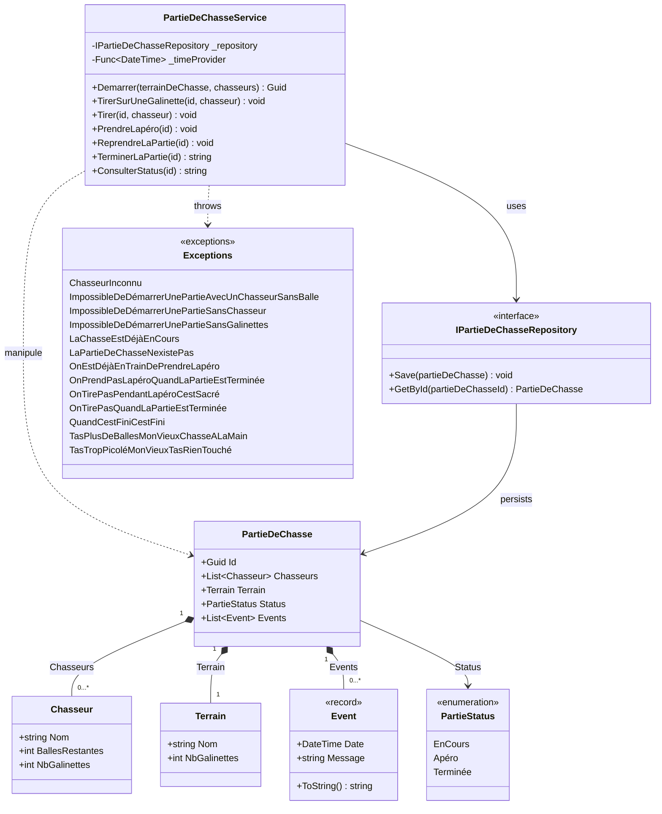

---
layout: section
---

<div class="flex items-center gap-16">

<div class="flex-1">

# Qui suis-je ?

<div class="accent-badge mb-6">Yoan Thirion</div>

- Responsable de la pédagogie - [école Coda Dijon](https://coda.school/)
- Software Crafter, Coach Agile, Juste un Dév
- GitHub : [@ythirion](https://github.com/ythirion)
- LinkedIn : [yoanthirion](https://www.linkedin.com/in/yoanthirion/)

</div>


</div>

---
layout: section
---

# Qui connait le Bouchonnois ?


---
layout: image
image: /quote-chasseurs.webp
---

---
codeSlide: true
---

<div class="flex items-center gap-12">

<div class="flex-1">


# Le contexte

> Nos valeureux chasseurs du Bouchonnois ont besoin de pouvoir gérer leurs parties de chasse.

<div class="accent-badge mt-6">Ils font appel à nous, devs du Bouchonnois, pour les aider à faire évoluer ce système</div>

</div>


</div>

<!--
Ils ont fait développer un système de gestion par l'entreprise Toshiba... et depuis, plus rien n'avance.
- Chaque nouvelle fonctionnalité prend plus de temps que la précédente
- L'entreprise parle d'une soi-disant dette technique, sans jamais l'expliquer
-->

---
layout: section
---

<div class="flex items-center gap-12">

<div class="flex-1">

# Prise en main du projet

- [ ] Backlogs et autres artefacts
- [ ] Technologies utilisées
- [ ] Compiler / exécuter le code : analyser les potentiels `Warning`
- [ ] Analyser la structure de la solution afin de comprendre l'architecture en place
- [ ] Regarder les dépendances afin de comprendre les interactions potentielles du système
- [ ] Calculer le `code coverage`
- [ ] Analyser le rapport d'analyse static de code
- [ ] Identifier s'il y a des [`hotspots`](https://understandlegacycode.com/blog/focus-refactoring-with-hotspots-analysis/) et où ils sont localisés

</div>
    <a href="https://canva.link/4b9mxwe0oxw67js" target="_blank">
        
    </a>
</div>

<!-- Libyear, Analyse comportementale de code, skill claude associée, C4 model, ... -->

---
codeSlide: true
---

<div class="relative h-full flex items-center justify-center">


<a href="https://xtrem-tdd.netlify.app/Flavours/Practices/example-mapping" target="_blank" class="link-preview link-preview-sm absolute top-1 right-1">
  <div class="link-preview-title">Example Mapping</div>
  <div class="link-preview-url">xtrem-tdd.netlify.app/Flavours/Practices/example-mapping</div>
</a>

</div>

---
layout: section
---

# Technologies utilisées

- `C#` / `.NET 10`
- `xUnit` + `NFluent`
- Coverage : `coverlet`
- Analyse statique de code : `SonarCloud`

---
layout: section
---

# Compiler


<div class="accent-badge mt-8">Aucun warning</div>

---
layout: section
---

# Architecture / Dépendances


---
codeSlide: true
---

<div class="h-full flex flex-col">

# Le code, en bref

<div class="mermaid-fit flex-1 min-h-0">



</div>

</div>

---
layout: section
---

# Calculer le code coverage

<div class="flex flex-col items-center gap-4">
  
  
</div>

---
layout: section
---

# Analyse static de code


---
layout: section
---


# Analyse static de code


---
layout: section
---

# Analyse comportementale de code


---
layout: section
---


<br/>

2 hostpots : `PartieDeChasseService.cs`, `PartieDeChasseServiceTests.cs`

---
codeSlide: true
---

# Il ressemble à quoi le code...

```csharp {all|27,34,39}{maxHeight:'380px'}
public void TirerSurUneGalinette(Guid id, string chasseur)
{
    var partieDeChasse = _repository.GetById(id);
    if (partieDeChasse == null)
    {
        throw new LaPartieDeChasseNexistePas();
    }
    if (partieDeChasse.Terrain.NbGalinettes != 0)
    {
        if (partieDeChasse.Status != PartieStatus.Apéro)
        {
            if (partieDeChasse.Status != PartieStatus.Terminée)
            {
                if (partieDeChasse.Chasseurs.Exists(c => c.Nom == chasseur))
                {
                    ...
                }
                else
                {
                    throw new ChasseurInconnu(chasseur);
                }
            }
            else
            {
                partieDeChasse.Events.Add(new Event(_timeProvider(), $"{chasseur} veut tirer -> On tire pas quand la partie est terminée"));
                _repository.Save(partieDeChasse);
                throw new OnTirePasQuandLaPartieEstTerminée();
            }
        }
        else
        {
            partieDeChasse.Events.Add(new Event(_timeProvider(), $"{chasseur} veut tirer -> On tire pas pendant l'apéro, c'est sacré !!!"));
            _repository.Save(partieDeChasse);
            throw new OnTirePasPendantLapéroCestSacré();
        }
    }
    else
    {
        throw new TasTropPicoléMonVieuxTasRienTouché();
    }
    _repository.Save(partieDeChasse);
}
```

---
layout: section
---

# Avant d'aller plus loin
Et si on faisait l'anatomie d'un test ?
Qu'est ce que vous associez à cela ?

---
codeSlide: true
---

# Anatomie d'un test

```csharp {all|1|6-7|9-12|14-15|17-19}
public class AddANewComment
{
    private const string Author = "Les Inconnus";
    private const string AComment = "C'est exactement ça !!!";
    
    [Fact]
    public void In_An_Article_Include_Author_And_Text()
    {
        // Arrange
        var article = new Article(
            "Chasse = Un Art ?",
            "C'est sur que la chasse c'est un art, pour d'autres ça peut être la peinture, la musique, tout ça mais pour nous c'est la chasse quoi c'est un art…");
        
        // Act
        var updatedArticle = article.AddComment(Author, AComment);

        // Assert
        updatedArticle.IsRight.Should().BeTrue();
        AssertComment(updatedArticle.RightUnsafe().Comments.Head, Author, AComment);
    }
    ...
}   
```

---
layout: section
---

# Les tests, notre filet de sécurité

<div class="text-lg space-y-4 max-w-3xl">

Sans effort, un code ne fait que se dégrader : c'est l'**entropie**.

Pour la combattre, il faut **refactorer** en permanence... et pour refactorer sereinement, il faut un filet de sécurité qui nous prévient dès qu'on casse un comportement : **les tests**.

<div class="accent-badge mt-4">Mais peut-on faire confiance aux tests actuels ?</div>

</div>

<!--
Le refactoring, c'est changer la structure du code sans changer son comportement.
Les tests sont là pour garantir que le comportement reste le même : ils nous donnent le courage de modifier le code.
Un filet troué donne une fausse impression de sécurité : c'est pire que pas de filet du tout.
C'est tout l'enjeu des histoires qui suivent.
-->

---
layout: section
---
# Les préceptes du Bouchonnois
Maintenant qu'on a une meilleure vue sur le code, appliquons les préceptes des meilleurs devs du Bouchonnois :

<div class="text-lg space-y-3 mt-4">

1. **Le bon test ne ment pas**
2. **Le bon test, on le lit**
3. **Le bon test couvre ce que tu n'as pas pensé à tester**
4. **Le bon test protège l'architecture**

</div>

---
layout: image
image: /01.le-bon-test-ne-ment-pas/tests-dont-lie.webp
---

---
codeSlide: true
---

# Un test du Bouchonnois

```csharp {all|1|4|6-15|17-18|20-21}{maxHeight:'380px'}
public class TirerSurUneGalinette
{
    [Fact]
    public void EchoueAvecUnChasseurNayantPlusDeBalles()
    {
        // Arrange
        var id = Guid.NewGuid();
        var repository = new PartieDeChasseRepositoryForTests();
        repository.Add(new PartieDeChasse(id, new Terrain("Pitibon sur Sauldre") {NbGalinettes = 3},
        [
            new("Dédé") { BallesRestantes = 20 },
            new("Bernard") { BallesRestantes = 0 },
            new("Robert") { BallesRestantes = 12 }
        ]));
        var service = new PartieDeChasseService(repository, () => DateTime.Now);

        // Act
        var tirerSansBalle = () => service.TirerSurUneGalinette(id, "Bernard");

        // Assert
        Check.ThatCode(tirerSansBalle).Throws<TasPlusDeBallesMonVieuxChasseALaMain>();
    }
}
```

---
codeSlide: true
---

# Et le code de production qu'il exerce ?

```csharp {all|6-7}{maxHeight:'380px'}
public void TirerSurUneGalinette(Guid id, string chasseur)
{
    ...
    if (chasseurQuiTire.BallesRestantes == 0)
    {
        partieDeChasse.Events.Add(new Event(_timeProvider(), 
            $"{chasseur} veut tirer sur une galinette -> T'as plus de balles mon vieux, chasse à la main"));
        _repository.Save(partieDeChasse);

        throw new TasPlusDeBallesMonVieuxChasseALaMain();
    }
    ...
```

<div class="mt-8 text-lg" v-click="1">

Ce système sert avant tout à répondre à une **exigence de traçabilité** : si un randonneur se fait tirer dessus, on doit pouvoir **retracer les événements**.

</div>

---
codeSlide: true
---

# Démo : mutation

<div class="text-lg space-y-3 max-w-2xl">

- On choisit une ligne du code de production
- On la modifie/supprime à la main - c'est notre `mutant`
- On relance la suite de tests

<div class="accent-badge mt-4" v-click="1">Si les tests passent toujours : le mutant a survécu...</div>

</div>

<!--
PartieDeChasseService.cs -> TirerSurUneGalinette (l. 91)
-->

---
layout: section
---

<div class="flex flex-col items-center gap-6 text-center">

# Quoi ?! 

Mais on a 100% de code coverage...

<div class="accent-badge">100% coverage sur tous les fichiers</div>

</div>

---
layout: section
---


---
codeSlide: true
---

# Code Coverage

> La couverture de code mesure quelle portion du code source est **exécutée** par la suite de tests.

```
Code Coverage (%) = ( Lignes exécutées par les tests / Lignes exécutables totales ) × 100
```

<div class="mt-6 space-y-2 text-lg">

- Une couverture **faible** (ex : 10%) prouve qu'on ne teste pas assez ✅
- Une couverture **élevée** (même 100%) ne prouve **pas** qu'on a de bons tests ❌

</div>

---
layout: statement
---

# Code Coverage : bon indicateur négatif, mauvais indicateur positif

<div class="accent-badge mt-6">Le coverage ne dit jamais si ce que tu as testé est bien testé</div>

---
codeSlide: true
---

<div class="flex items-center gap-12">

<div class="flex-1">

# Le Mutation Testing à la rescousse ?

Introduire volontairement un petit bug (un `mutant`) dans le code de production, puis relancer les tests.

```
Mutation Score (%) = ( Mutants tués / Mutants générés ) × 100
```

<div class="mt-6 space-y-2 text-lg">

- Un test échoue → le mutant est **tué** → le comportement est réellement vérifié
- Tous les tests passent → le mutant **survit** → aucun test ne vérifie ce comportement

</div>

</div>


</div>

---
layout: section
---

<div class="flex items-center gap-12">

<div class="flex-1">

# Stryker : trouve des mutants pour nous

```bash
dotnet tool install -g dotnet-stryker
```

```bash
cd src
dotnet stryker
```

</div>

<div class="flex flex-col items-center gap-4 flex-shrink-0 w-72">


<a href="https://stryker-mutator.io/docs/stryker-net/introduction/" target="_blank" class="link-preview w-full">
  <div class="link-preview-title">Stryker.NET</div>
  <div class="link-preview-url">stryker-mutator.io/docs/stryker-net</div>
</a>

</div>

</div>

---
layout: section
---

# Exemples de Mutators

<div class="flex flex-row items-center justify-center gap-4">
  
  
  
</div>

<a href="https://stryker-mutator.io/docs/stryker-net/mutations/" target="_blank" class="link-preview link-preview-sm mt-6 mx-auto w-fit">
  <div class="link-preview-title">Mutators</div>
  <div class="link-preview-url">stryker-mutator.io/docs/stryker-net/mutations</div>
</a>

---
layout: section
---

# Rapport de mutation


---
layout: section
---

# Removal / Statement mutation

<div class="flex flex-col items-center gap-4">
  
</div>

---
codeSlide: true
---

# Comment tuer un mutant ?

<div class="flex gap-6 items-start">

<div class="w-2/3" style="--slidev-code-font-size: 0.62rem; --slidev-code-line-height: 1.45;">

```csharp {all|4,14|19|20-24}
[Fact]
public void EchoueAvecUnChasseurNayantPlusDeBalles()
{
    var now = new DateTime(2024, 6, 6, 14, 50, 45);
    var id = Guid.NewGuid();
    var repository = new PartieDeChasseRepositoryForTests();
    repository.Add(new PartieDeChasse(id,
        new Terrain("Pitibon sur Sauldre") { NbGalinettes = 3 },
        [
            new("Dédé") { BallesRestantes = 20 },
            new("Bernard") { BallesRestantes = 0 },
            new("Robert") { BallesRestantes = 12 }
        ]));
    var service = new PartieDeChasseService(repository, () => now);
    var tirerSansBalle = () => service.TirerSurUneGalinette(id, "Bernard");

    Check.ThatCode(tirerSansBalle).Throws<TasPlusDeBallesMonVieuxChasseALaMain>();

    var events = repository.SavedPartieDeChasse()!.Events;
    Check.That(events).HasSize(1);
    Check.That(events[0])
        .IsEqualTo(new Event(now,
            "Bernard veut tirer sur une galinette -> " +
            "T'as plus de balles mon vieux, chasse à la main"));
}
```

</div>

<div class="flex-1 space-y-4">

<div v-click="1">

**1. Figer le temps** : `() => now` plutôt que `() => DateTime.Now`, pour pouvoir comparer un `Event`

</div>

<div v-click="2">

**2. Relire la partie sauvegardée** : si `_repository.Save` disparaît, plus de partie à relire

</div>

<div v-click="3">

**3. Vérifier l'événement émis** : s'il disparaît ou change de message, le test échoue

</div>

<div v-click="4" class="accent-badge">On relance Stryker : le mutant est tué</div>

</div>

</div>

<!--
- Le test existant ne vérifiait que le type de l'exception
- Les mutants tués : statement mutation sur `Events.Add` et `_repository.Save` (l. 91-93), string mutation sur le message de l'événement
- Même stratégie sur les tests voisins (`EchoueCarLeChasseurNestPasDansLaPartie` -> `.WithMessage(...)` + `Check.That(repository.SavedPartieDeChasse()).IsNull()`)
-->
---
layout: image
image: /01.le-bon-test-ne-ment-pas/a-few-minutes-later.webp
---

---
layout: section
---

# Plus de mutants !


---
codeSlide: true
---

# Ce qu'il faut retenir

<div class="grid grid-cols-2 gap-8 mt-4">

<div>

### Code Coverage
Métrique **quantitative**

Combien de lignes/branches sont *exécutées* par les tests

</div>

<div>

### Mutation Testing
Métrique **qualitative**

En quoi ce qui est exécuté est réellement *vérifié* par les tests

</div>

</div>

<div class="mt-8 text-lg space-y-2">

- Permet de jauger la **qualité** de nos tests
- Permet aussi d'identifier des **cas limites** auxquels on n'avait pas pensé

</div>

<div class="accent-badge mt-6">Lent à exécuter</div>

---
layout: image
image: /02.le-bon-test-on-le-lit/le-bon-test-on-le-lit.webp
---

---
layout: statement
---

# "Any fool can write code that a computer can understand. Good programmers write code that humans can understand."

Martin Fowler

---
codeSlide: true
---

# Un test qu'il faut déchiffrer

On a tué nos mutants. `Events` est vérifié partout, `Stryker` est content. 

Regardons `AvecUnChasseurAyantDesBallesEtAssezDeGalinettesSurLeTerrain` une fois corrigé :

```csharp {all|17-25|27|29-37}{maxHeight:'340px'}
public class PartieDeChasseServiceTests
{
    private static readonly DateTime Now = new(2024, 6, 6, 14, 50, 45);
    private static readonly Func<DateTime> TimeProvider = () => Now;

    private static void AssertLastEvent(PartieDeChasse partieDeChasse, string expectedMessage)
    {
        Check.That(partieDeChasse.Events).HasSize(1);
        Check.That(partieDeChasse.Events[0]).IsEqualTo(new Event(Now, expectedMessage));
    }

    public class TirerSurUneGalinette
    {
        [Fact]
        public void AvecUnChasseurAyantDesBallesEtAssezDeGalinettesSurLeTerrain()
        {
            var id = Guid.NewGuid();
            var repository = new PartieDeChasseRepositoryForTests();
            repository.Add(new PartieDeChasse(id, new Terrain("Pitibon sur Sauldre") {NbGalinettes = 3},
            [
                new("Dédé") { BallesRestantes = 20 },
                new("Bernard") { BallesRestantes = 8 },
                new("Robert") { BallesRestantes = 12 }
            ]));
            var service = new PartieDeChasseService(repository, TimeProvider);

            service.TirerSurUneGalinette(id, "Bernard");

            var savedPartieDeChasse = repository.SavedPartieDeChasse();
            Check.That(savedPartieDeChasse!.Id).IsEqualTo(id);
            Check.That(savedPartieDeChasse.Status).IsEqualTo(PartieStatus.EnCours);
            Check.That(savedPartieDeChasse.Terrain.Nom).IsEqualTo("Pitibon sur Sauldre");
            Check.That(savedPartieDeChasse.Terrain.NbGalinettes).IsEqualTo(2);
            Check.That(savedPartieDeChasse.Chasseurs).HasSize(3);
            // ... 8 lignes de Check.That sur Dédé, Bernard, Robert

            AssertLastEvent(savedPartieDeChasse, "Bernard tire sur une galinette");
        }
    }
}
```

---
layout: section
---

<div class="text-lg space-y-4 max-w-3xl">

# Ce test ne ment plus. Mais...

<div class="accent-badge mt-4">Combien de temps pour dire ce que ce test prouve, sans l'exécuter ?</div>

</div>

---
layout: statement
---

# Une seule classe, `848+` lignes, des dizaines de tests qui se ressemblent tous

<div class="accent-badge mt-6">Un bon test se lit / comprend en 5 secondes</div>

---
codeSlide: true
---

# Test Data Builders

> Un petit truc facile à mettre en place

<div class="grid grid-cols-2 gap-8 mt-4">

<div class="flex flex-col gap-4">

Sans builder :

```csharp
var address = new Address(
    "Rue Sainte Catherine",
    "Bordeaux",
    new PostalCode("33000", "1 Bis"));
```

<div class="accent-badge">Si le constructeur d'Address change, chaque test qui construit une Address doit changer</div>

</div>

<v-click>

<div class="flex flex-col gap-4">

Avec un `Test Data Builder` :

```csharp
var address = ANewAddress()
    .At("Bordeaux")
    .InStreet("Rue Sainte Catherine")
    .WithPostalCode(_ => _.WithNumber("1 Bis"))
    .Build();
```

<a href="https://blog.ploeh.dk/2017/08/15/test-data-builders-in-c/" target="_blank" class="link-preview link-preview-sm w-fit">
  <div class="link-preview-title">Test Data Builders in C#</div>
  <div class="link-preview-url">blog.ploeh.dk/2017/08/15/test-data-builders-in-c</div>
</a>

</div>

</v-click>

</div>

---
codeSlide: true
---

# Le Builder : un point d'interception

<div class="flex items-center gap-12">

<div class="flex-1 min-w-0">


```csharp {all|28-29}{maxHeight:'320px'}
public class AddressBuilder
{
    private string _city = "Paris";
    private string _street = "";
    private PostalCodeBuilder _postalCode = new();

    public static AddressBuilder ANewAddress() => new();

    public AddressBuilder At(string city)
    {
        _city = city;
        return this;
    }

    public AddressBuilder InStreet(string street)
    {
        _street = street;
        return this;
    }

    public AddressBuilder WithPostalCode(
        Func<PostalCodeBuilder, PostalCodeBuilder> configure)
    {
        _postalCode = configure(_postalCode);
        return this;
    }

    // Seul endroit qui connaît la signature du constructeur d'Address
    public Address Build() => new(_street, _city, _postalCode.Build());
}
```

</div>

<div class="flex-shrink-0 w-72 text-lg">

Si `Address` gagne un champ, perd un champ, ou change l'ordre de ses paramètres : **un seul fichier à modifier**.

<div class="accent-badge mt-4">Pas de résistance aux refactorings</div>

</div>

</div>

---
layout: statement
---

# "This eliminates the irrelevant, and amplifies the essentials of the test."

Robert C. Martin

---
codeSlide: true
---

# Démo : écrire son premier Test Data Builder

<div class="flex flex-row items-center gap-8">

<v-click>
    
</v-click>

<div class="flex-1">

On écrit d'abord, en mots, ce qu'on voudrait pouvoir écrire, puis on génère le code depuis l'IDE.

<a href="https://xtrem-tdd.netlify.app/Flavours/generate-code-from-usage" target="_blank" class="link-preview link-preview-sm mt-4">
  <div class="link-preview-title">Generate Code From Usage</div>
  <div class="link-preview-url">xtrem-tdd.netlify.app/Flavours/generate-code-from-usage</div>
</a>

</div>

</div>

<!--
DÉMO (repo atelier ; solution sur `histoires/02.le-bon-test-se-lit`, dossier `src/Bouchonnois.Tests/Builders/`)
1. Repartir du test `AvecUnChasseurAyantDesBallesEtAssezDeGalinettesSurLeTerrain` (`PartieDeChasseServiceTests.cs` l. 95)
   -> identifier dans l'Arrange ce qui compte : le nb de galinettes et les chasseurs présents
2. Écrire d'abord ce qu'on voudrait lire (le code ne compile pas encore) :
   var partieDeChasse = UnePartieDeChasseDuBouchonnois()
       .SurUnTerrainRicheEnGalinettes()
       .Avec(Dédé(), Bernard(), Robert())
       .Build();
3. Generate Code From Usage depuis l'IDE (Alt+Entrée) :
   - `Builders/PartieDeChasseBuilder.cs` : `UnePartieDeChasseDuBouchonnois()` (static), `SurUnTerrainRicheEnGalinettes(int nbGalinettes = 3)`, `Avec(params ChasseurBuilder[])`, `Build()`
   - `Builders/ChasseurBuilder.cs` : Object Mothers `Dédé()` (20 balles), `Bernard()` (8), `Robert()` (12), `Build()`
4. Remplacer l'Arrange : `repository.Add(partieDeChasse);` puis `TirerSurUneGalinette(partieDeChasse.Id, "Bernard")`
5. Vérifier que le test reste vert, puis montrer qu'il détecte toujours un mutant :
   commenter `chasseurQuiTire.NbGalinettes++;` (`PartieDeChasseService.cs` l. 99) -> ROUGE, remettre la ligne
-->

---
codeSlide: true
---

# PartieDeChasseBuilder

```csharp {all|7|3-5|9-13|21-26}{maxHeight:'380px'}
public class PartieDeChasseBuilder
{
    private int _nbGalinettes = 3;
    private PartieStatus _status = PartieStatus.EnCours;
    private ChasseurBuilder[] _chasseurs = [];

    public static PartieDeChasseBuilder UnePartieDeChasseDuBouchonnois() => new();

    public PartieDeChasseBuilder SurUnTerrainRicheEnGalinettes(int nbGalinettes = 3)
    {
        _nbGalinettes = nbGalinettes;
        return this;
    }

    public PartieDeChasseBuilder Avec(params ChasseurBuilder[] chasseurs)
    {
        _chasseurs = chasseurs;
        return this;
    }

    public PartieDeChasse Build() => new(
        Guid.NewGuid(),
        new Terrain("Pitibon sur Sauldre") { NbGalinettes = _nbGalinettes },
        _chasseurs.Select(c => c.Build()).ToList(),
        _status
    );
}
```

---
codeSlide: true
---

# ChasseurBuilder : Builder + Object Mother

```csharp {all|13-16}{maxHeight:'380px'}
public class ChasseurBuilder
{
    private readonly string _nom;
    private int _ballesRestantes;
    private int _nbGalinettes;

    private ChasseurBuilder(string nom, int ballesRestantes)
    {
        _nom = nom;
        _ballesRestantes = ballesRestantes;
    }

    // Object Mothers
    public static ChasseurBuilder Dédé() => new("Dédé", ballesRestantes: 20);
    public static ChasseurBuilder Bernard() => new("Bernard", ballesRestantes: 8);
    public static ChasseurBuilder Robert() => new("Robert", ballesRestantes: 12);

    public Chasseur Build() => new(_nom)
    {
        BallesRestantes = _ballesRestantes,
        NbGalinettes = _nbGalinettes
    };
}
```

---
layout: section
---

# Ça vaut aussi pour les assertions !!!


---
codeSlide: true
---

# Premier réflexe : `Should` / `Have`

```csharp
savedPartieDeChasse.ShouldHaveChasseurWith("Bernard", ballesRestantes: 7, galinettes: 1);
savedPartieDeChasse.ShouldHaveGalinettesOnTerrain(2);
savedPartieDeChasse.ShouldHaveEmittedEvent(Now, "Bernard tire sur une galinette");
```

<div class="mt-8 text-lg max-w-2xl">

Déjà bien plus lisible qu'un bloc de `Check.That`. Mais `Should` / `Have` restent du vocabulaire de **testeur**, pas du vocabulaire **métier** - jamais dans la bouche d'un chasseur du Bouchonnois.

</div>

---
codeSlide: true
---

# On nomme dans le langage du métier

```csharp {all|3-9|11-18|20-24}{maxHeight:'340px'}
public static class PartieDeChasseAssertions
{
    public static PartieDeChasse AÉmisLÉvénement(
        this PartieDeChasse partieDeChasse, DateTime expectedTime, string expectedMessage)
    {
        Check.That(partieDeChasse.Events).HasSize(1);
        Check.That(partieDeChasse.Events[0]).IsEqualTo(new Event(expectedTime, expectedMessage));
        return partieDeChasse;
    }

    public static PartieDeChasse ContientLeChasseurAvec(
        this PartieDeChasse partieDeChasse, string nom, int ballesRestantes, int galinettes)
    {
        var chasseur = partieDeChasse.Chasseurs.Single(c => c.Nom == nom);
        Check.That(chasseur.BallesRestantes).IsEqualTo(ballesRestantes);
        Check.That(chasseur.NbGalinettes).IsEqualTo(galinettes);
        return partieDeChasse;
    }

    public static PartieDeChasse ContientLesGalinettes(this PartieDeChasse partieDeChasse, int nbGalinettes)
    {
        Check.That(partieDeChasse.Terrain.NbGalinettes).IsEqualTo(nbGalinettes);
        return partieDeChasse;
    }
}
```

---
layout: section
---

<div class="text-lg space-y-4 max-w-3xl">

# Pourquoi ça compte vraiment ?

Chaînées, ces assertions se lisent comme une phrase qui décrit l'état attendu de la partie de chasse - pas comme une checklist technique.

C'est le nom de la méthode qui apparaît dans le message d'échec quand le test devient rouge :

```
at PartieDeChasseAssertions.ContientLeChasseurAvec(...)
```

<div class="accent-badge mt-4">Moins de traduction mentale entre l'échec et sa compréhension = moins de charge cognitive</div>

</div>

---
codeSlide: true
---

# Le test se réduit à ce qui compte

```csharp {all|3-7|9|11-14}{maxHeight:'380px'}
public void AvecUnChasseurAyantDesBallesEtAssezDeGalinettesSurLeTerrain()
{
    var partieDeChasse = AvecUnePartieDeChasseExistante(
        UnePartieDeChasseDuBouchonnois()
            .SurUnTerrainRicheEnGalinettes()
            .Avec(Dédé(), Bernard(), Robert())
    );

    PartieDeChasseService.TirerSurUneGalinette(partieDeChasse.Id, "Bernard");

    Repository.SavedPartieDeChasse()!
        .ContientLeChasseurAvec("Bernard", ballesRestantes: 7, galinettes: 1)
        .ContientLesGalinettes(2)
        .AÉmisLÉvénement(Now, "Bernard tire sur une galinette");
}
```

<div class="accent-badge mt-6">De 33 à 8 lignes</div>

---
layout: statement
---

# Le bon test, on le lit en 5 secondes

<div class="accent-badge mt-6">Test Data Builders + Object Mothers + assertions métier</div>

---
codeSlide: true
---

# Ce qu'il faut retenir

<div class="mt-4 text-lg space-y-2">

- **Test Data Builders + Object Mothers** : cachent le bruit de l'`Arrange`, ne laissent apparaître que ce qui compte pour le test
- **Assertions métier** (`ContientLeChasseurAvec`, `AÉmisLÉvénement`, ...) : le nom de la méthode devient le message d'erreur quand le test échoue

</div>

<div class="accent-badge mt-6">

Élimine ce qui n'est pas pertinent, et amplifie l'essentiel du test.

</div>

---
layout: image
image: 04.le-bon-test-couvre-ce-que-tu-nas-pas-pense-a-tester/le-bon-test-couvre-ce-que-tu-nas-pas-imagine.webp
---

---
codeSlide: true
---

# Un exemple, c'est un point. La règle, c'est une droite.

```csharp
[Fact]
public Task AvecPlusieursChasseurs()
{
    var command = DémarrerUnePartieDeChasse()
        .Avec((Chasseurs.Dédé, 20), (Chasseurs.Bernard, 8), (Chasseurs.Robert, 12))
        .SurUnTerrainRicheEnGalinettes(3);

    PartieDeChasseService.Demarrer(command.Terrain, command.Chasseurs);

    return Verify(Repository.SavedPartieDeChasse())
        .DontScrubDateTimes();
}
```

<div class="mt-6 text-lg">3 chasseurs nommés, un terrain à 3 galinettes. Est-ce que ce sont ces valeurs précises qui comptent - ou une règle plus générale qu'elles illustrent ?</div>

---
layout: statement
---

# Un seul test avec des exemples fixes ne peut te dire que : "ça marche pour ces valeurs-là"

---
layout: section
---


<div class="text-center mt-4">Les tests <code>example-based</code> couvrent bien la conformité métier, mal l'espace des entrées possibles</div>

---
layout: section
---
# Le concept : Property-Based Testing

<div class="flex items-center gap-12">

<div class="flex-1">


On fixe une **règle** censée être vraie pour *toute* entrée valide, puis on laisse un framework **générer** des dizaines d'entrées aléatoires pour essayer de la mettre en défaut.

</div>

<a href="https://xtrem-tdd.netlify.app/Flavours/Testing/pbt/" target="_blank" class="link-preview flex-shrink-0">
  <div class="link-preview-title">Property-Based Testing</div>
  <div class="link-preview-url">xtrem-tdd.netlify.app/Flavours/Testing/pbt</div>
</a>

</div>

---
layout: section
---


---
layout: section
hide: true
---


<div class="text-center mt-4">Un <code>Generator</code> produit les entrées, un <code>Shrinker</code> réduit l'entrée qui a fait échouer la propriété au plus petit cas possible</div>

---
layout: section
---

<div class="flex items-center gap-12">

<div class="flex-1">

# FsCheck

```bash
dotnet add package FsCheck.Xunit
```

```csharp
using FsCheck.Fluent;
using FsCheck.Xunit;
```

</div>

<a href="https://fscheck.github.io/FsCheck/Properties.html" target="_blank" class="link-preview flex-shrink-0">
  <div class="link-preview-title">FsCheck</div>
  <div class="link-preview-url">fscheck.github.io/FsCheck/Properties.html</div>
</a>

</div>

---
codeSlide: true
---

# Écrire une propriété : l'addition

<div class="text-lg mb-2">On annote avec <code>[Property]</code>, on retourne une <code>Property</code> - un prédicat passé à <code>.ToProperty()</code>. FsCheck génère lui-même les paramètres.</div>

```csharp {all|1-4|6-9|11-14}
// Commutativité : l'ordre des termes n'a pas d'importance -> 2 + 3 = 3 + 2
[Property]
public Property Commutativity(int x, int y) =>
    (Add(x, y) == Add(y, x)).ToProperty();

// Associativité : peu importe comment on regroupe les additions -> (x + 1) + 1 = x + 2
[Property]
public Property Associativity(int x) =>
    (Add(Add(x, 1), 1) == Add(x, 2)).ToProperty();

// Élément neutre : ajouter 0 laisse le nombre inchangé -> x + 0 = x
[Property]
public Property Identity(int x) =>
    (Add(x, 0) == x).ToProperty();
```

---
layout: section
---

# Quelles propriétés identifier ?


---
codeSlide: true
---

# Démarrer une partie : identifier la règle

```text
forall (terrain avec des galinettes, groupe de chasseurs tous armés)
La partie de chasse doit démarrer avec succès
```

<div class="mt-6 text-lg space-y-2">

- Peu importe le nom du terrain ou des chasseurs
- Peu importe leur nombre
- Seule compte la précondition : au moins 1 galinette, au moins 1 balle chacun

</div>

---
codeSlide: true
---

# Les générateurs

```csharp {all|1-2|4-7|9-12|14-17}{maxHeight:'380px'}
private static FsCheck.Gen<string> NomGenerator()
    => ArbMap.Default.GeneratorFor<string>().Where(nom => !string.IsNullOrWhiteSpace(nom));

private static FsCheck.Arbitrary<(string nom, int nbGalinettes)> TerrainRicheEnGalinettesGenerator()
    => (from nom in NomGenerator()
        from nbGalinettes in Gen.Choose(1, 1000)
        select (nom, nbGalinettes)).ToArbitrary();

private static FsCheck.Gen<(string nom, int nbBalles)> ChasseurArméGenerator()
    => from nom in NomGenerator()
        from nbBalles in Gen.Choose(1, 1000)
        select (nom, nbBalles);

private static FsCheck.Arbitrary<List<(string nom, int nbBalles)>> GroupeDeChasseursArmésGenerator()
    => (from nbChasseurs in Gen.Choose(1, 50)
        from chasseurs in Gen.ListOf(ChasseurArméGenerator(), nbChasseurs)
        select chasseurs).ToArbitrary();
```

---
codeSlide: true
---

# La propriété

```csharp {all}{maxHeight:'380px'}
[Property]
public FsCheck.Property Sur1TerrainAvecGalinettesEtDesChasseursArmésLaPartieDémarre()
    => Prop.ForAll(
        TerrainRicheEnGalinettesGenerator(),
        GroupeDeChasseursArmésGenerator(),
        (terrain, chasseurs) =>
        {
            var id = PartieDeChasseService.Demarrer(terrain, chasseurs);
            return Repository.SavedPartieDeChasse()!.Id == id;
        });
```

<div class="mt-6 text-lg">1 seul test qui vaut, à lui seul, des dizaines d'exécutions de <code>Demarrer</code> avec des entrées différentes à chaque run.</div>

---
layout: statement
---

# Les cas non-passants aussi sont des propriétés

---
codeSlide: true
---

# Sans chasseurs

```text
forall (terrain riche en galinettes)
La partie ne démarre pas sans chasseurs
```

<v-click>

```csharp {all}{maxHeight:'380px'} 
[Property]
public FsCheck.Property SansChasseursSurNImporteQuelTerrainRicheEnGalinettes()
    => Prop.ForAll(
        TerrainRicheEnGalinettesGenerator(),
        terrain =>
            EchoueAvec<ImpossibleDeDémarrerUnePartieSansChasseur>(
                terrain,
                [],
                savedPartieDeChasse => savedPartieDeChasse == null));
```

</v-click>

---
codeSlide: true
---

# Sans galinettes

```csharp {all|1-5|10-11|13-16}
private static FsCheck.Arbitrary<(string nom, int nbGalinettes)> TerrainSansGalinettesGenerator()
    => (from nom in NomGenerator()
        // On généralise au-delà de 0 : n'importe quelle valeur "pas au moins 1" doit échouer
        from nbGalinettes in Gen.Choose(-1000, 0)
        select (nom, nbGalinettes)).ToArbitrary();

[Property]
public FsCheck.Property SurNImporteQuelTerrainSansGalinettesLaPartieNeDémarrePas()
    => Prop.ForAll(
        TerrainSansGalinettesGenerator(),
        GroupeDeChasseursArmésOuVideGenerator().ToArbitrary(),
        (terrain, chasseurs) =>
            EchoueAvec<ImpossibleDeDémarrerUnePartieSansGalinettes>(
                terrain,
                chasseurs,
                savedPartieDeChasse => savedPartieDeChasse == null));
```

<div class="mt-4 text-lg">Le code original ne vérifiait que <code>0</code> galinette. La propriété teste aussi <code>-1</code>, <code>-847</code>, ... - des cas que personne n'aurait pensé à écrire à la main.</div>

---
codeSlide: true
---

Complémentaire avec des tests d'exemples

```csharp {all|3-15|18-28|32-41}{maxHeight:'340px'}
public class DemarrerUnePartieDeChasse : PartieDeChasseServiceTest
{
    // Exemple-based test
    [Fact]
    public Task AvecPlusieursChasseurs()
    {
        var command = DémarrerUnePartieDeChasse()
            .Avec((Chasseurs.Dédé, 20), (Chasseurs.Bernard, 8), (Chasseurs.Robert, 12))
            .SurUnTerrainRicheEnGalinettes(3);

        PartieDeChasseService.Demarrer(command.Terrain, command.Chasseurs);

        return Verify(Repository.SavedPartieDeChasse())
            .DontScrubDateTimes();
    }
    ...
    
    // PBT : cas passant
    [Property]
    public FsCheck.Property Sur1TerrainAvecGalinettesEtDesChasseursArmésLaPartieDémarre()
        => Prop.ForAll(
            TerrainRicheEnGalinettesGenerator(),
            GroupeDeChasseursArmésGenerator(),
            (terrain, chasseurs) =>
            {
                var id = PartieDeChasseService.Demarrer(terrain, chasseurs);
                return Repository.SavedPartieDeChasse()!.Id == id;
            });

    ...
    
    // PBT : cas non passants
    [Property]
    public FsCheck.Property SansChasseursSurNImporteQuelTerrainRicheEnGalinettes()
        => Prop.ForAll(
            TerrainRicheEnGalinettesGenerator(),
            terrain =>
                EchoueAvec<ImpossibleDeDémarrerUnePartieSansChasseur>(
                    terrain,
                    [],
                    savedPartieDeChasse => savedPartieDeChasse == null));
    ...
```

<div class="accent-badge mt-4">Pas un remplacement</div>

---
codeSlide: true
---

# Ce qu'il faut retenir

<div class="mt-4 text-lg space-y-2">

- Une règle générale, pas une valeur : `forall(x, y, ...) la propriété tient`
- Les cas passants **et** les cas d'échec se prêtent aux propriétés
- Une propriété qui échoue se réduit (`shrinking`) au plus petit cas qui casse encore

</div>

<div class="accent-badge mt-6">Le bon test couvre ce que tu n'as pas pensé à tester</div>

---
layout: image
image: 05.le-bon-test-protege-larchitecture/cover.webp
---

---
layout: statement
---

# J'ai déjà retrouvé un connecteur Kafka en plein cœur d'un Domain Model...

---
codeSlide: true
---

# Le Bouchonnois et ailleurs ?

<div class="text-lg space-y-2 mt-4">

- Jour 1 : une belle archi, co-construite, ultra clean
  - Le projet grossit, les devs tournent, les cas d'usage se complexifient
- Résultat : tout dépend de tout, plus personne ne mesure l'impact d'un changement

</div>

<div class="accent-badge mt-6">Coder les règles, les vérifier en continu éviterait ce genre de situation</div>

<!-- exactement ce qui a manqué au Kafka du dessus -->

---
layout: statement
---

# Comment garantir la pérennité de nos principes / guidances d'architecture ?

---
layout: section
---

# Le concept : Architecture (Unit) Tests

<div class="flex items-center gap-12">

<div class="flex-1">


Une règle de conception - une frontière entre couches, un sens de dépendance - vérifiée automatiquement, à chaque run, exactement comme n'importe quel autre test.

</div>

<a href="https://xtrem-tdd.netlify.app/Flavours/Architecture/archunit" target="_blank" class="link-preview flex-shrink-0">
  <div class="link-preview-title">Architecture Unit Tests</div>
  <div class="link-preview-url">xtrem-tdd.netlify.app/Flavours/Architecture/archunit</div>
</a>

</div>

---
layout: section
---

# Onion Architecture


<div class="text-center mt-4">Le <code>Domain Model</code> au centre - les couches externes en dépendent, jamais l'inverse</div>

---
layout: section
---

# Ports & Adapters


<div class="text-center mt-4">Un <code>Port</code> (l'interface) appartient au <code>Domain</code> - seul un <code>Adapter</code> concret appartient à l'infrastructure</div>

<a href="https://xtrem-tdd.netlify.app/Flavours/Architecture/clean-architecture" target="_blank" class="link-preview link-preview-sm absolute top-1 right-1">
  <div class="link-preview-title">Clean Architecture</div>
  <div class="link-preview-url">xtrem-tdd.netlify.app/Flavours/Architecture/clean-architecture</div>
</a>

---
layout: section
---

<div class="flex items-center gap-12">

<div class="flex-1">

# ArchUnitNET

```bash
dotnet add package TngTech.ArchUnitNET.xUnit
```

```csharp
using ArchUnitNET.Fluent;
using ArchUnitNET.Loader;
using ArchUnitNET.xUnit;
using static ArchUnitNET.Fluent.ArchRuleDefinition;
```

</div>

<a href="https://github.com/TNG/ArchUnitNET" target="_blank" class="link-preview flex-shrink-0">
  <div class="link-preview-title">ArchUnitNET</div>
  <div class="link-preview-url">github.com/TNG/ArchUnitNET</div>
</a>

</div>

---
codeSlide: true
---

# Le Domain ne dépend de rien d'autre...

```csharp {1-16|18-22}{maxHeight:'340px'}
private static GivenTypesConjunctionWithDescription ApplicationServices() =>
    ArchUnitExtensions.TypesInAssembly().And()
        .ResideInNamespaceMatching(".*Service.*")
        .As("Application Services");

private static GivenTypesConjunctionWithDescription DomainModel() =>
    ArchUnitExtensions.TypesInAssembly().And()
        .ResideInNamespaceMatching(".*Domain.*")
        .As("Domain Model");

private static GivenTypesConjunctionWithDescription Infrastructure() =>
    ArchUnitExtensions.TypesInAssembly().And()
        .ResideInNamespaceMatching(".*Repository.*")
        .As("Infrastructure");

[Fact]
public void DomainModelRules() =>
    DomainModel().Should()
        .NotDependOnAny(ApplicationServices()).AndShould()
        .NotDependOnAny(Infrastructure())
        .Check();
```

---
codeSlide: true
---

# Démo

<v-click>

```csharp
// Ajout temporaire dans PartieDeChasse.cs
public class PartieDeChasse
{
    public Terrain? Terrain { get; set; }
    private PartieDeChasseService? _service; // <- vrai couplage, cette fois
    ...
}
```

```text
FailedArchRuleException:
	Bouchonnois.Domain.PartieDeChasse does depend on "Bouchonnois.Service.PartieDeChasseService"
```

<div class="mt-4 text-lg">Rouge, avec un message qui pointe la classe et la dépendance en cause. On retire le champ temporaire, on revient au vert.</div>

</v-click>

<!--
DÉMO (repo atelier, branche `histoires/05.le-bon-test-protege-larchitecture`)
1. Montrer `src/Bouchonnois.Tests/Architecture/ArchitectureRules.cs` : `ArchUnitExtensions` (ArchLoader sur l'assembly de `PartieDeChasseService`) + `DomainModelRules`
2. Lancer `DomainModelRules` : VERT
   (sur `main`, le `using Bouchonnois.Service;` mort de `PartieDeChasse.cs` l. 1 ne fait pas échouer la règle : ArchUnitNET lit le compilé, pas le source)
3. Casser volontairement : dans `src/Bouchonnois/Domain/PartieDeChasse.cs`, ajouter un champ
   `private PartieDeChasseService? _service;` (+ `using Bouchonnois.Service;` si absent)
4. Relancer : ROUGE -> `Bouchonnois.Domain.PartieDeChasse does depend on "Bouchonnois.Service.PartieDeChasseService"`
5. Retirer le champ, revenir au vert. "Never trust a test you haven't seen fail"
-->

---
layout: statement
---

# Le port du repository : où doit vivre `IPartieDeChasseRepository` ?

---
codeSlide: true
---

# On déplace le port dans le Domain

```csharp
// Bouchonnois/Domain/IPartieDeChasseRepository.cs (déplacé depuis Repository/)
namespace Bouchonnois.Domain;

public interface IPartieDeChasseRepository
{
    void Save(PartieDeChasse partieDeChasse);
    PartieDeChasse GetById(Guid partieDeChasseId);
}
```

```csharp 
[Fact]
public void ApplicationServicesRules() =>
    ApplicationServices().Should()
        .NotDependOnAny(Infrastructure())
        .Check();
```

<div class="mt-4 text-lg"><code>Bouchonnois.Repository</code> ne contient plus aucune classe de production - il attend une future implémentation concrète.</div>

---
codeSlide: true
---

# Des règles d'équipe

```csharp {1-6|8-15|17-22}{maxHeight:'340px'}
[Fact]
public void NoGetMethodShouldReturnVoid() =>
    Methods()
        .HaveNameMatching("Get[A-Z].*").Should()
        .NotHaveReturnType(typeof(void))
        .Check();

[Fact]
public void IserAndHaserShouldReturnBooleans() =>
    Methods()
        .HaveNameMatching("Is[A-Z].*").Or()
        .HaveNameMatching("Has[A-Z].*").Should()
        .HaveReturnType(typeof(bool))
        .WithoutRequiringPositiveResults()
        .Check();

[Fact]
public void InterfacesShouldStartWithI() =>
    InterfaceTypes().Should()
        .HaveNameMatching("^I[A-Z].*")
        .Because("C# convention...")
        .Check();
```

<div class="mt-4 text-lg"><code>WithoutRequiringPositiveResults()</code> : un Given vide n'est pas toujours un signe que la règle est inutile - certaines conventions restent "vides" pendant des mois, prêtes à réagir.</div>

---
codeSlide: true
---

# Ce qu'il faut retenir

<div class="mt-4 text-lg space-y-2">

- Un `Architecture Test` protège la **structure**, pas le comportement
- Il garantit dans le temps le respect des principes/guidances d'architecture - pas juste au moment où l'archi a été dessinée
- En complément de l'analyse statique de code (`SonarCloud`, ...), pas à sa place : elle regarde le code, lui regarde les dépendances entre composants

</div>

<div class="accent-badge mt-6">Le bon test protège l'architecture - et entretient la confiance qu'on lui porte</div>

---
codeSlide: true
---

# 4 questions à se poser

<div class="flex items-center gap-12">

<div class="flex-1 mt-4 text-base space-y-1.5">

**Histoire 1 : Le bon test ne ment pas**
- [ ] Ce test a-t-il déjà échoué pour une bonne raison ?

**Histoire 2 : Le bon test, on le lit**
- [ ] Est-ce que je le comprends en 5 secondes, ou dois-je le déchiffrer ?

**Histoire 3 : Le bon test couvre ce que tu n'as pas pensé à tester**
- [ ] Ne couvre-t-il que les valeurs que j'ai pensé à écrire ?

**Histoire 4 : Le bon test protège l'architecture**
- [ ] Protège-t-il aussi la structure, ou seulement le comportement ?

</div>


</div>


---
layout: image
image: /conclusion/aoc.webp
link: https://coda-dijon.github.io/advent-2026/
---

---
class: merci-slide
---

# Merci

<div class="flex items-center justify-center gap-12">


</div>
